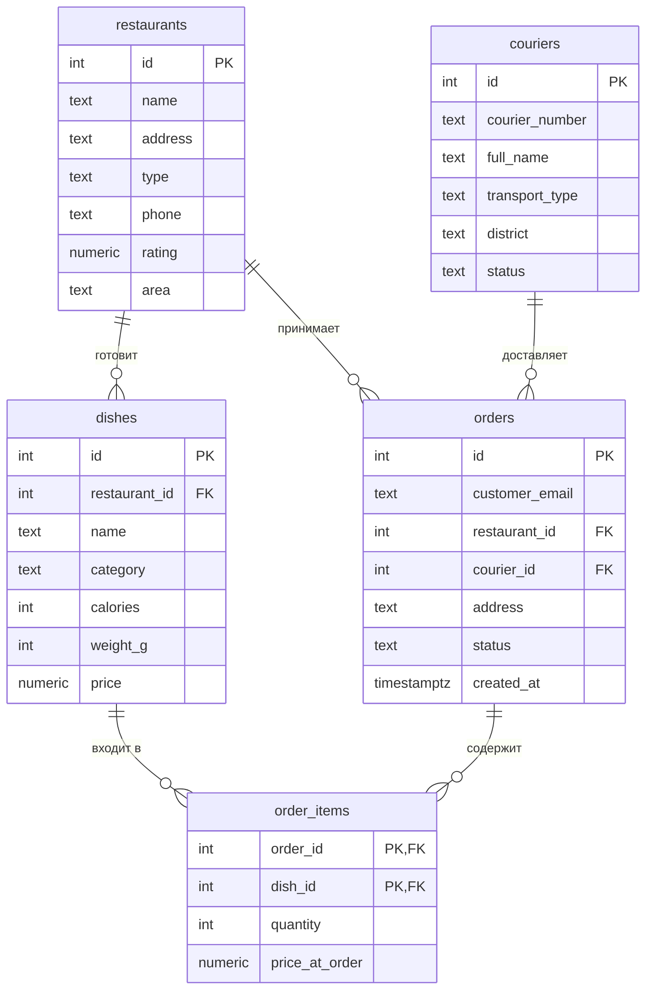

# Доставка еды

Тема № 9: **Доставка еды**. База хранит данные о ресторанах, их меню, курьерах, заказах клиентов и позициях этих заказов. Нужна сервису доставки, чтобы принимать заказы, назначать курьеров и считать стоимость.

| | |
| --- | --- |
| Главная таблица | `orders` |
| Связь N:M | `orders` и `dishes` через `order_items` |
| Бизнес-правило | У курьера не больше 3 активных заказов |
| СУБД | PostgreSQL 17 в Docker |

## Описание предметной области

Система автоматизирует доставку еды из ресторанов. Клиенты оформляют заказы через приложение: выбирают ресторан, блюда и адрес доставки. Рестораны публикуют меню, у каждого блюда указаны категория, состав, КБЖУ, вес и цена. Курьеры привязаны к районам города и перемещаются на разном транспорте — пешком, на велосипеде или на машине. Каждый заказ состоит из нескольких позиций, одна позиция — это блюдо и его количество. У одного заказа один ресторан и один курьер, но курьер может везти много заказов, а ресторан — принимать много заказов. Одно и то же блюдо может входить в разные заказы, поэтому между заказами и блюдами реализована связь «многие ко многим» через таблицу `order_items`.

## Задания курса

Правила курса, установка и порядок сдачи: [docs/README.md](docs/README.md).

| Лаба | Задание |
| --- | --- |
| 1. Модель данных и схема | [docs/lab-1.md](docs/lab-1.md) |
| 2. Запросы | [docs/lab-2.md](docs/lab-2.md) |
| 3. Логика в базе | [docs/lab-3.md](docs/lab-3.md) |
| 4. Транзакции и доступ | [docs/lab-4.md](docs/lab-4.md) |
| 5. Производительность | [docs/lab-5.md](docs/lab-5.md) |
| Витрина к защите | [docs/showcase.md](docs/showcase.md) |

## Как запустить

```bash
cp .env.example .env          # пароли и порт
docker compose up -d          # при первом запуске выполняются скрипты из db/
dbcheck run demo/lab1.sql     # сценарий лабы 1
```

## ER-диаграмма


## Ограничения

| Ограничение | Таблица и колонки | Зачем |
| --- | --- | --- |
| `UNIQUE` | `restaurants.name` | Название ресторана не должно повторяться |
| `UNIQUE` | `couriers.courier_number` | Номер курьера уникален |
| `CHECK` | `dishes.price > 0` | Цена не может быть отрицательной или нулём |
| `CHECK` | `dishes.weight_g > 0` | Вес блюда должен быть положительным |
| `CHECK` | `couriers.transport_type IN (...)` | Только пеший, машина или велосипед |
| `CHECK` | `orders.status IN (...)` | Статус заказа — из фиксированного набора |

## Нормализация

Схема приведена к третьей нормальной форме (3НФ):
- **1НФ:** в каждой ячейке одно значение. Ингредиенты хранятся строкой, а список блюд заказа вынесен в отдельную таблицу `order_items`.
- **2НФ:** в таблице `order_items` составной первичный ключ `(order_id, dish_id)`. Поля `quantity` и `price_at_order` зависят от обоих ключей.
- **3НФ:** транзитивных зависимостей нет. Название ресторана хранится только в таблице `restaurants`, а в `dishes` и `orders` используются внешние ключи (`restaurant_id`).
Сознательная денормализация: в `order_items` хранится `price_at_order`, чтобы зафиксировать историческую цену блюда на момент заказа.

## Что сделано по лабам

| Лаба | Что сделано | Сценарий |
| --- | --- | --- |
| 1 | Схема (5 таблиц, N:M, ограничения), данные, три плохие вставки, генератор на 1000+ строк | `demo/lab1.sql`, `db/03_generate.sql` |
| 2 | 16 запросов (JOIN, GROUP BY, подзапросы, DML, CTE) | `demo/lab2.sql` |
| 3 | Представления, функции, процедура, триггеры (правило 3-х заказов, updated_at, журнал jsonb) | `demo/lab3.sql`, `db/10_views.sql`, `db/11_functions.sql`, `db/12_triggers.sql` |
| 4 | ... | `demo/lab4.sql`, `demo/race.sql`, `demo/race_fixed.sql` |
| 5 | ... | `demo/lab5.sql` |